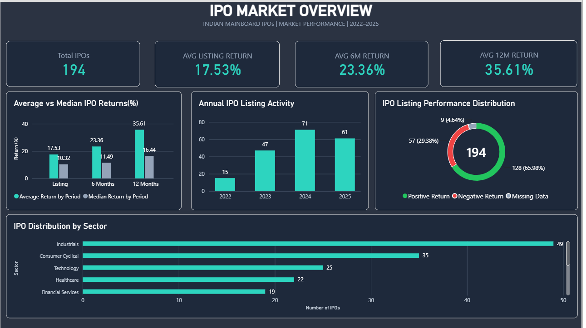
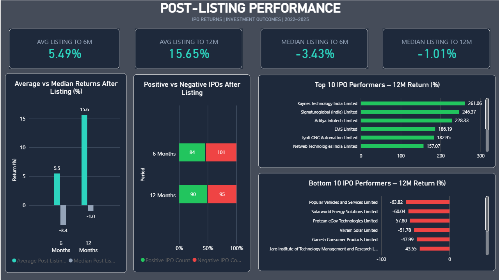
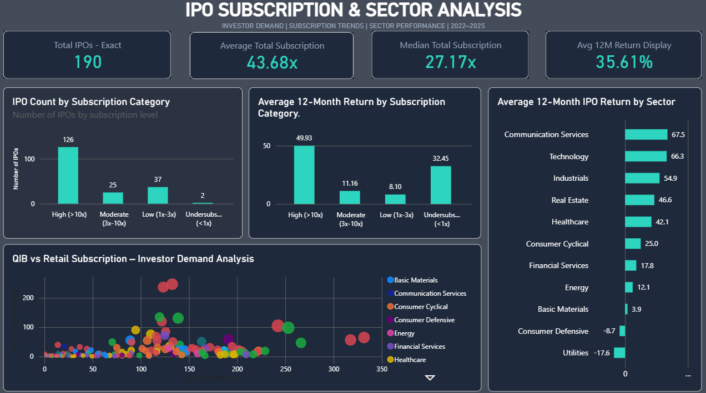
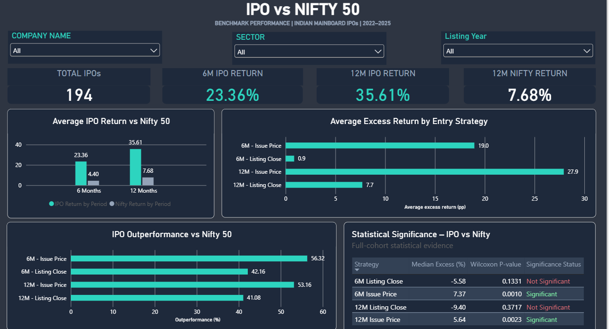

# Do IPOs Actually Make Money After Listing Day?

## Project Overview

This project analyses **194 Indian Mainboard IPOs** listed between **30 October 2022 and 30 October 2025** to understand whether IPOs generate positive returns after listing.

The analysis compares IPO returns from the issue price and listing-day closing price across listing day, 6-month and 12-month periods.

The project combines Python-based data collection, data cleaning, exploratory data analysis, statistical analysis and an interactive Power BI dashboard.

## Business Objectives

- Evaluate IPO listing-day performance.
- Analyse 6-month and 12-month post-listing returns.
- Compare issue-price and listing-close investment strategies.
- Identify positive and negative IPO performance.
- Explore subscription patterns and sector-wise performance.
- Compare IPO returns against the Nifty 50 benchmark.
- Identify trends that can support better IPO investment decisions.

## Business Questions

1. How many IPOs generate positive and negative listing-day returns?
2. Do listing-day gains continue over 6-month and 12-month periods?
3. How do returns differ between issue-price and listing-close investments?
4. What percentage of IPOs remain profitable after 6 and 12 months?
5. Which sectors demonstrate stronger or weaker IPO performance?
6. Is IPO subscription demand associated with subsequent returns?
7. Do highly subscribed IPOs perform better than less-subscribed IPOs?
8. Do IPO investments outperform the Nifty 50 benchmark?
9. How do average returns compare with median returns?

## Tools & Technologies

- **Python** – Data collection, cleaning and analysis
- **Pandas, NumPy** – Data manipulation and numerical analysis
- **yfinance** – Historical stock price data
- **Requests** – API and web-data requests
- **Jupyter Notebook** – Data analysis and documentation
- **Power BI** – Interactive dashboard development
- **CSV / Excel** – Data storage and inspection
- **Git & GitHub** – Version control and project documentation

## Project Scope

| Parameter | Details |
|---|---|
| Market | Indian Mainboard IPOs |
| IPO Count | 194 |
| Listing Period | 30 October 2022 – 30 October 2025 |
| Return Periods | Listing Day, 6 Months, 12 Months |
| Benchmark | Nifty 50 |
| Dashboard | 4 Power BI Pages |

## Repository Structure

```text
Do-IPOs-actually-make-money-after-listing-day/
│
├── Dashboard/
│   ├── IPO_Analysis_Dashboard.pbix
│   ├── 01_market_overview.png
│   ├── 02_post_listing_performance.png
│   ├── 03_subscription_sector_analysis.png
│   └── 04_ipo_vs_nifty50.png
│
├── data/
│   ├── raw/
│   │   └── ipo_master_raw.csv
│   │
│   └── processed/
│       ├── historical_stock_prices.csv
│       ├── ipo_analysis_cohort.csv
│       ├── ipo_master_analysis.csv
│       ├── ipo_master_backup.csv
│       ├── ipo_nifty_benchmark_analysis.csv
│       ├── ipo_nifty_statistical_tests.csv
│       ├── ipo_returns_analysis.csv
│       ├── ipo_sector_mapping.csv
│       ├── ipo_sector_mapping_final.csv
│       ├── ipo_subscription_backup.csv
│       ├── ipo_subscription_data.csv
│       ├── listing_date_exceptions.csv
│       ├── stock_download_status.csv
│       └── subscription_api_errors.csv
│
├── notebooks/
│   ├── 01_IPO_Data_Collection.ipynb
│   ├── 02_IPO_Exploratory_Analysis.ipynb
│   └── 03_Nifty_50_Benchmark_Analysis.ipynb
│
├── report/
│   └── IPO_Insight_Memo.pdf
│
├── .gitignore
├── README.md
└── requirements.txt
```

## Notebook Documentation

### 1. IPO Data Collection

**File:** `01_IPO_Data_Collection.ipynb`

**Objective:** Collect, clean and prepare the datasets required for IPO analysis.

**Activities:**

- IPO master data preparation.
- Selection of the IPO analysis cohort.
- Identification of stock symbols and listing dates.
- Historical stock price data collection.
- IPO subscription data collection.
- Handling missing records and data exceptions.
- Preparation of datasets for further analysis.

**Key Outputs:**

- IPO cohort dataset.
- Historical stock prices.
- IPO returns dataset.
- Subscription dataset.
- Data collection status and exception files.

### 2. IPO Exploratory Data Analysis

**File:** `02_IPO_Exploratory_Analysis.ipynb`

**Objective:** Analyse IPO performance, subscription patterns and sector-wise trends.

**Activities:**

- Listing-day return analysis.
- 6-month and 12-month return analysis.
- Issue-price versus listing-close return comparison.
- Average and median return analysis.
- Positive and negative return distribution.
- Identification of severe-loss IPOs.
- Sector-wise performance analysis.
- Subscription category analysis.
- QIB, NII and Retail subscription analysis.
- Relationship between subscription demand and IPO returns.

**Key Outputs:**

- IPO performance analysis.
- Subscription analysis.
- Sector-wise return analysis.
- Analytical findings used in the Power BI dashboard.

### 3. Nifty 50 Benchmark Analysis

**File:** `03_Nifty_50_Benchmark_Analysis.ipynb`

**Objective:** Compare IPO investment returns against the Nifty 50 benchmark.

**Activities:**

- Nifty 50 historical data preparation.
- Matching IPO investment periods with benchmark periods.
- 6-month and 12-month benchmark return calculation.
- Issue-price investment comparison.
- Listing-close investment comparison.
- Excess return calculation.
- Statistical testing of IPO and benchmark performance.

**Key Outputs:**

- `ipo_nifty_benchmark_analysis.csv`
- `ipo_nifty_statistical_tests.csv`

## Data Preparation & Methodology

### Investment Strategies

**Strategy 1 – Issue Price Investment**

Assumes an investor receives IPO shares at the issue price.

Return Formula:

Return (%) = ((Exit Price - Issue Price) / Issue Price) × 100

**Strategy 2 – Listing Close Investment**

Assumes an investor purchases the stock at the listing-day closing price.

Post-Listing Return Formula:

Return (%) = ((Horizon Price - Listing Close) / Listing Close) × 100

### Return Calculation

- Listing-day returns are calculated using the IPO issue price and listing-day closing price.
- 6-month and 12-month returns are calculated using the first available trading observation on or after the respective target date.
- Actual observation dates may differ from target dates because of non-trading days.
- Missing price observations are retained as missing values and are not treated as zero.
- Valid sample sizes may differ across return periods.

### Subscription Analysis

Subscription data is analysed across:

- Qualified Institutional Buyers (QIB)
- Non-Institutional Investors (NII)
- Retail Individual Investors (Retail)
- Total Subscription

Subscription levels are compared with IPO returns to identify possible relationships and patterns.

### Sector Analysis

IPOs are grouped by sector to evaluate differences in 12-month returns and identify sectors with stronger or weaker performance.

### Nifty 50 Benchmark Analysis

IPO returns are compared with Nifty 50 returns over matching investment periods.

Excess Return Formula:

Excess Return (percentage points) = IPO Return (%) - Nifty 50 Return (%)

The comparison is performed separately for issue-price and listing-close investment strategies.

## Power BI Dashboard

The project includes a **four-page interactive Power BI dashboard** designed to present the major findings.

### Dashboard 1 – IPO Market Overview

**Objective:** Provide an overview of the IPO market and overall listing performance.

**Key Visuals:**

- Total IPO count and key performance KPIs.
- Average versus median IPO returns.
- Sector-wise IPO distribution.
- Annual IPO listing activity.
- Listing-day positive and negative performance distribution.



### Dashboard 2 – Post-Listing Performance

**Objective:** Evaluate how IPOs perform after the listing day.

**Key Visuals:**

- Average listing-to-6-month return.
- Average listing-to-12-month return.
- Median 6-month and 12-month returns.
- Average versus median performance comparison.
- Positive and negative IPO counts.
- Top 10 and bottom 10 IPO performers based on listing-to-12-month returns.



### Dashboard 3 – IPO Subscription & Sector Analysis

**Objective:** Understand the relationship between IPO subscription demand and post-listing performance.

**Key Visuals:**

- Total IPO count and subscription KPIs.
- IPO count by subscription category.
- Average 12-month returns by subscription category.
- Sector-wise average 12-month returns.
- QIB versus Retail subscription comparison.
- Subscription and return scatter analysis.



### Dashboard 4 – IPO vs Nifty 50 Benchmark Analysis

**Objective:** Compare IPO investment performance against the Nifty 50 benchmark.

**Key Visuals:**

- 6-month and 12-month benchmark comparisons.
- Issue-price and listing-close investment strategies.
- IPO versus Nifty 50 return comparison.
- Excess return analysis.
- Statistical test results.
- Benchmark methodology notes.



## Key Findings

### 1. Post-Listing Performance

Listing-close investment strategy results:

| Metric | 6 Months | 12 Months |
|---|---:|---:|
| Average Return | 5.49% | 15.65% |
| Median Return | -3.43% | -1.01% |
| Positive IPOs | 84 | 90 |
| Negative IPOs | 101 | 95 |
| Valid Observations | 185 | 185 |

The positive average return alongside a slightly negative median return indicates that a smaller number of high-performing IPOs influence the overall average.

### 2. IPO Subscription Analysis

| Metric | Result |
|---|---:|
| Total IPOs | 194 |
| Exact Final Subscription Records | 190 |
| Mean Total Subscription | 43.68x |
| Median Total Subscription | 27.17x |
| Minimum Subscription | 0.53x |
| Maximum Subscription | 229.68x |

### 3. Subscription and Return Relationship

Spearman rank correlation between total subscription and issue-price returns:

| Return Period | Correlation |
|---|---:|
| Listing Day | 0.686 |
| 6 Months | 0.355 |
| 12 Months | 0.272 |

The results indicate a positive association between subscription demand and returns in the observed IPO cohort. However, correlation does not establish causation.

### 4. IPO vs Nifty 50

| Investment Strategy | Period | Mean Excess Return |
|---|---|---:|
| Issue Price | 6 Months | +18.96 percentage points |
| Listing Close | 6 Months | +0.86 percentage points |
| Issue Price | 12 Months | +27.93 percentage points |
| Listing Close | 12 Months | +7.71 percentage points |

The results demonstrate that the entry price has an important influence on the investor's return experience.

Mean excess return and the percentage of IPOs outperforming the benchmark measure different aspects of performance.

## Statistical Analysis

The project uses the following statistical methods:

- **Spearman Rank Correlation:** Evaluates the association between subscription demand and IPO returns.
- **Wilcoxon Signed-Rank Test:** Evaluates paired differences between IPO and benchmark returns.
- **Binomial Test:** Evaluates the proportion of IPOs outperforming the benchmark against a 50% reference proportion.

Statistical significance should be interpreted considering sample size, missing observations, test assumptions and multiple comparisons.

## Limitations

1. **Missing Price Data:** Historical price observations are unavailable for a small number of IPOs or return periods.
2. **Subscription Data Coverage:** Complete subscription records are not available for every IPO.
3. **Data Source:** Historical stock prices were retrieved using Yahoo Finance data access and should be independently validated.
4. **Benchmark Limitation:** The Nifty 50 comparison uses the price index and does not include dividends.
5. **Sector Sample Size:** Some sectors contain relatively few IPOs, making their average returns sensitive to individual stocks.
6. **Observational Analysis:** Subscription and sector relationships are descriptive and do not establish causation.
7. **Trading Costs:** Brokerage, taxes, slippage and financing costs are not included.
8. **Investment Risk:** Historical performance does not guarantee future returns.

## How to Run the Project

### Step 1 – Clone the Repository

```bash
git clone https://github.com/Udayan-SS/Do-IPOs-actually-make-money-after-listing-day-.git
```

### Step 2 – Navigate to the Project Folder

```bash
cd Do-IPOs-actually-make-money-after-listing-day-
```

### Step 3 – Create a Virtual Environment

```bash
python -m venv .venv
```

Activate the environment in Windows PowerShell:

```powershell
.venv\Scripts\Activate.ps1
```

### Step 4 – Install Required Libraries

```bash
pip install -r requirements.txt
```

### Step 5 – Launch Jupyter Notebook

```bash
jupyter notebook
```

### Step 6 – Execute the Notebooks in Sequence

1. `01_IPO_Data_Collection.ipynb`
2. `02_IPO_Exploratory_Analysis.ipynb`
3. `03_Nifty_50_Benchmark_Analysis.ipynb`

Some data collection steps require internet access and external data-source availability.

### Step 7 – Open the Power BI Dashboard

Open the following file:

`Dashboard/IPO_Analysis_Dashboard.pbix`

If Power BI requests data-source paths, update them to the local `data/processed/` folder.

## Project Report

The detailed project report is available here:

`report/IPO_Insight_Memo.pdf`

The report summarizes the analysis, key findings, methodology and limitations.

## Disclaimer

This project is developed for **educational, analytical and portfolio demonstration purposes only**.

It does not constitute investment advice or a recommendation to subscribe to, buy or sell any security. Historical returns do not guarantee future performance. Data should be independently verified before making financial decisions.

## Author

**Udayan SS**

- GitHub: [Udayan-SS](https://github.com/Udayan-SS)
- LinkedIn: [Udayan SS](https://www.linkedin.com/in/udayan-ss-8ba888226/)
